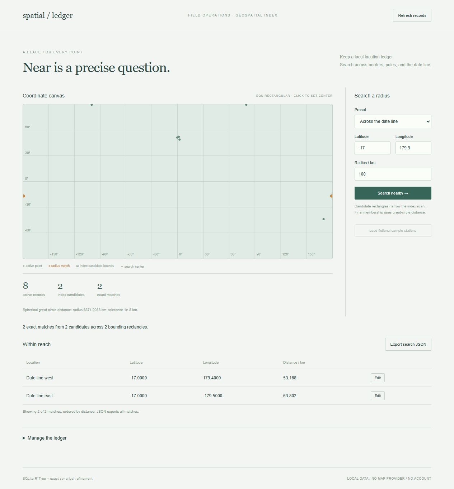

# Spatial Ledger

A persistent local location ledger with SQLite R*Tree candidate filtering, spherical radius refinement, versioned edits, atomic imports, and recoverable archive/restore.



## Run

Requires Python 3.10+ with SQLite's R*Tree extension enabled. Standard Python distributions commonly include it; the test suite exercises it directly. No third-party packages or frontend build step:

```sh
python run.py
```

Open http://127.0.0.1:8000. Optional flags: `--port 8001 --db /path/to/points.sqlite3`. The default database lives in `data/points.sqlite3`, which is ignored by Git. A fresh checkout starts empty; load the fictional sample stations from the UI.

## Workflows

- Add or edit named latitude/longitude records. Edits include an expected record version; concurrent stale writes return HTTP 409 instead of silently overwriting changes.
- Search by center and radius, or click the coordinate canvas to set a center. Presets demonstrate ordinary searches, crossing ±180°, pole-spanning bounds, and a whole-globe search.
- Inspect active-record, index-candidate, and exact-match counts. Matches are ordered by computed distance, then record ID. The table shows at most 100; the JSON export includes all.
- Archive records without deleting them, and restore them from the ledger. Archived points remain versioned but leave the spatial index and search results.
- Import up to 500 points per batch; the entire batch succeeds or rolls back. The ledger holds 2,000 records including archived points.
- Export active points as importable JSON. Imports **append** new records; identical names and coordinates are allowed. Exports omit internal IDs, versions, and archived records.

Example import:

```json
{"points": [
  {"name": "West relay", "latitude": -17, "longitude": 179.4},
  {"name": "East relay", "latitude": -17, "longitude": -179.5}
]}
```

## Spatial model

Coordinates use latitude −90…90 and longitude −180…180 degrees; +180 is normalized to −180. Distances use a sphere with radius 6371.0088 km and a stable haversine/atan2 calculation. Radius is bounded to 0…20,100 km. Boundary inclusion uses a 1e−8 km numerical tolerance. “Exact” means exact membership under this spherical model, not survey-grade ellipsoidal distance.

The radius produces conservative latitude/longitude candidate bounds. Bounds crossing the date line split into two rectangles; bounds reaching a pole span all longitudes. SQLite R*Tree overlap queries retrieve candidates, then distances from the original double-precision coordinates refine them. Candidate IDs are deduplicated before refinement.

SQLite stores R*Tree coordinates as outward-rounded 32-bit bounds, so overlap queries can include extra candidates without excluding valid point entries. See the [official SQLite R*Tree documentation](https://www.sqlite.org/rtree.html), particularly roundoff and overlap queries. This app retains the authoritative coordinates in a separate ordinary table.

The map is an equirectangular **coordinate canvas**, not a navigation basemap. Rectangles visualize index bounds, not a radius circle. Area and distance are distorted in this projection, especially near poles; use the computed distances for membership decisions. Sample station names and locations are illustrative.

## Storage and API

`spatial.py` owns validation, geometry, and storage. SQLite triggers update the R*Tree inside the same transaction as record inserts, moves, archives, and restores. `BEGIN IMMEDIATE` serializes capacity checks and versioned writes. Search reads use a transaction so candidate rows and active counts come from one snapshot. WAL mode permits concurrent readers; every request closes its connection.

| Endpoint | Request / behavior |
| --- | --- |
| `GET /api/points` | All records, including versions and archive state |
| `GET /api/samples` | Fictional starter records; does not save them |
| `POST /api/points` | `{points:[...]}` atomic append |
| `POST /api/search` | `{latitude,longitude,radius}` with radius in km |
| `POST /api/points/{id}/edit` | `{version,point:{name,latitude,longitude}}` |
| `POST /api/points/{id}/archive` | `{version}` |
| `POST /api/points/{id}/restore` | `{version}` |

The server binds to loopback, allowlists static assets, validates Host/Origin on requests, requires JSON for writes, limits request bodies to 400 KB, and exposes no database or source-file routes. This is a local single-user tool; it does not implement remote authentication, multi-tenant permissions, or a production deployment stack.

## Verify

Node.js 22+ is needed only for the frontend syntax check:

```sh
python -m unittest discover -s tests -v
npm run check
```

13 Python tests cover known spherical distances, date-line splitting, pole-spanning queries, zero radius, exact boundary inclusion, whole-globe queries, and 180 searches over 503 points compared with an independent vector-cross/dot full scan. Storage tests cover persistence, R*Tree integrity, two concurrent writers with one successful version match, rollback after a deliberately injected mid-batch failure, archive/restore, capacity, strict input validation, and HTTP boundaries. CI runs Python 3.11/3.13 on Linux and Windows.

Browser checks exercised sample loading, date-line/polar searches, search exports, create/move/archive/restore, and page reloads. A downloaded date-line report was independently checked. Runtime test records remain in the ignored local database; they are not published.
